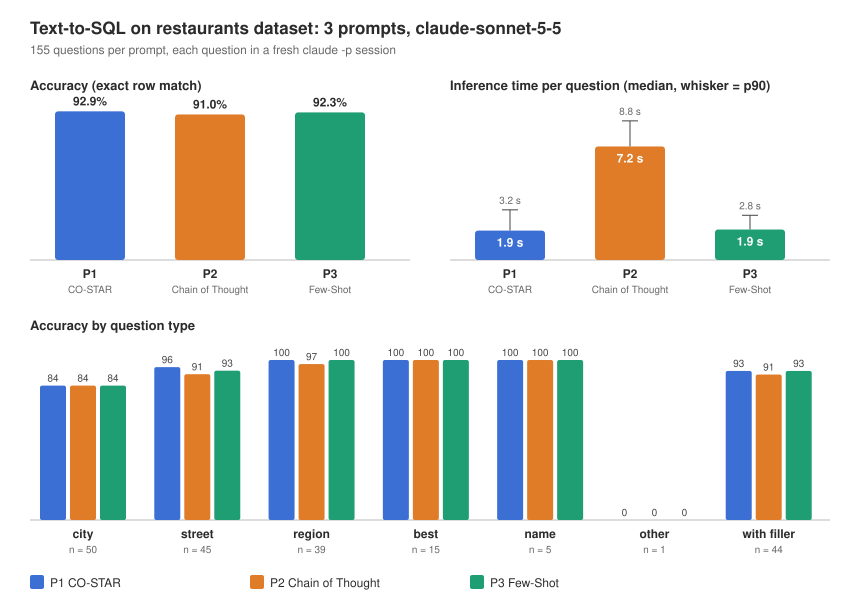

# Task 2 Report

Model: Claude Sonnet 5.5 (`claude-sonnet-5-5`), one fresh `claude -p` session per question, all 155 questions per prompt. A query counts as correct only if it returns exactly the reference rows.

| Prompt | Accuracy | Median time | Output tokens | Cost |
|---|---|---|---|---|
| P1 CO-STAR | 92.9 % (144) | 1.9 s | 212 | $0.72 |
| P2 Chain of Thought | 91.0 % (141) | 7.2 s | 956 | $1.88 |
| P3 Few-Shot | 92.3 % (143) | 1.9 s | 198 | $0.72 |

Time is the model's API time per call, without CLI startup.

Accuracy is nearly the same for all three. Eleven questions fail for every prompt, mostly city lists where the queries return a few more rows than the reference. Chain of Thought is almost four times slower and over twice as expensive, and its extra analysis added its own errors: it "cleaned up" values like `ave.` to `ave`. Few-Shot over-applied its "drop 'the'" rule once. The filler text in the questions didn't hurt any prompt.

For this task I'd use CO-STAR or Few-Shot.
