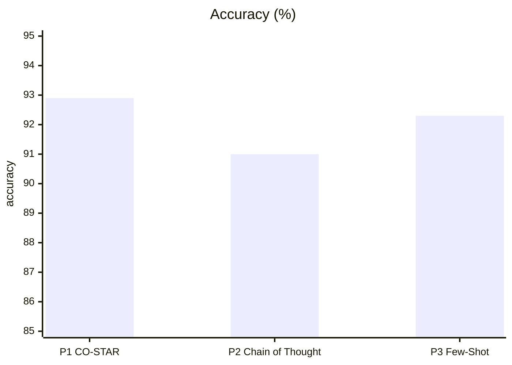
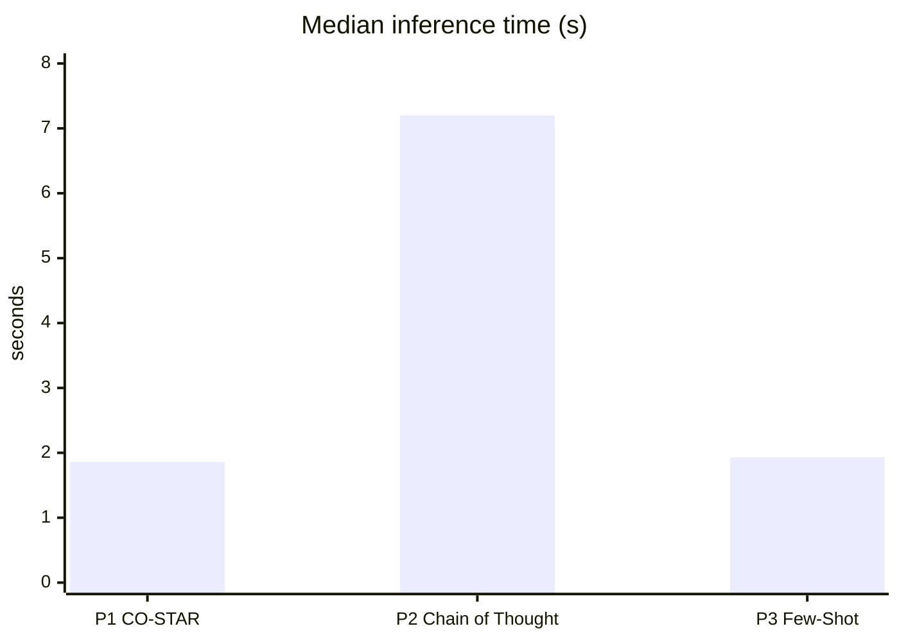

# Task 4 Report

All numbers come from `significance.py`, run on the Task 2 predictions (155 questions, each answered by all three prompts).

| Prompt | Correct | Accuracy (95 % CI) | Diner Score | Median time (IQR) | Median output tokens |
|---|---|---|---|---|---|
| P1 CO-STAR | 144 | 0.929 (0.877–0.960) | 0.965 | 1.86 s (1.66–2.23) | 180 |
| P2 Chain of Thought | 141 | 0.910 (0.854–0.945) | 0.948 | 7.20 s (6.33–7.75) | 998 |
| P3 Few-Shot | 143 | 0.923 (0.870–0.955) | 0.961 | 1.93 s (1.71–2.24) | 176 |

| Pair | Only first right | Only second right | McNemar p | Diner diff (bootstrap 95 %) | Wilcoxon p, Diner | Wilcoxon p, time |
|---|---|---|---|---|---|---|
| P1 vs P2 | 3 | 0 | 0.25 | +0.017 (−0.002 to 0.043) | 0.25 | 3.5e-27 |
| P1 vs P3 | 1 | 0 | 1.00 | +0.004 (−0.006 to 0.019) | 1.00 | 0.86 |
| P2 vs P3 | 1 | 3 | 0.63 | −0.013 (−0.039 to 0.013) | 0.63 | 3.5e-27 |

Cochran's Q over all three prompts is 3.50 (p = 0.17).

The accuracy differences are not significant. The prompts disagree on only four questions, and McNemar would need at least six one-sided disagreements to reach p < 0.05. Speed is the one real difference: Chain of Thought was slower on all 155 questions.

The prompt explains the time. Chain of Thought writes about 1,000 tokens of analysis before its query, while the others write fewer than 200. That analysis also caused its three extra errors, because it "tidied" values like `ave.` into `ave`.

The model explains why accuracy is so flat. Sonnet 5.5 handles this simple schema well with any structured prompt. Eleven questions fail for all three prompts with nearly identical SQL, so those failures come from the reference answers or the model, not the prompt.

The coding agent shaped the setup. Claude Code wrote all three prompts in one style, and each `claude -p` call added about 7 s of startup, which I left out of the times.
