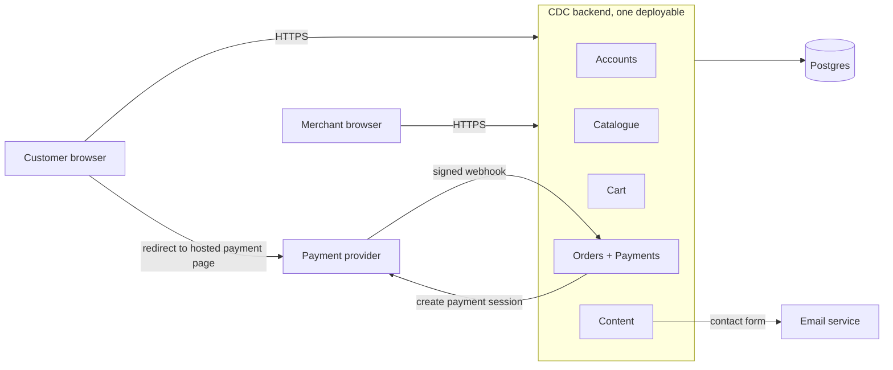

# ADR-001: Use a modular monolith for the CDC shop

- Status: accepted
- Date: 2026-10-27
- Deciders: Nikolas Gubancok, with Claude Code

## Context and problem statement

CDC is a hardware store e-shop with two roles, customer and merchant. The requirements have 25 user stories: accounts, product list and detail, search by name, sort by price, cart, payment, order status, product management, an About Us page and a contact form.

The system description calls CDC a "distributed system", but no story needs our own code to run as several processes. The requirements give no numbers for users, traffic or catalogue size. No payment provider or carrier is named, and there is no stock story.

We need an architecture that covers all stories, takes the "distributed" wording seriously, and that a small team can build and run.

## Decision drivers

- All 25 stories must be covered.
- "Distributed system" is a stated constraint. We may challenge it, but not ignore it.
- Payment correctness: an order is never marked paid twice, and never left unpaid after a real charge.
- Small team and low operating cost.
- A clear path to split the system later if load or team size grows.

## Considered options

1. Modular monolith
2. Microservices with an API gateway (three services: Identity, Catalogue, Ordering)
3. Event-driven architecture with CQRS (catalogue and orders on events via RabbitMQ)

| Decision driver | 1. Modular monolith | 2. Three services | 3. Event-driven + CQRS |
|---|---|---|---|
| Covers all 25 stories | Yes | Yes | Yes |
| "Distributed" constraint | Met through external parts (provider, email, browser, DB) | Met literally, own code in 3 processes | Met literally, broker and async consumers |
| Payment correctness | One webhook handler, one transaction | Same handler in Ordering, gateway must pass the raw body | Outbox, idempotent consumers, read lag on the order page |
| Team size and operating cost | Low: one deploy, one DB | Medium: 3 deploys, timeouts, retries | High: broker, relay, dead-letter queue |
| Path to split later | Packages map onto services | Already split | Already split, events in place |

## Decision outcome

Chosen option: modular monolith.

It covers every story with one deployable backend and one Postgres database, and checkout stays a single database transaction. The "distributed" constraint is met by the parts of the system that really are distributed: browser to backend, the external payment provider and its webhooks, the email service and the database host. Nothing in the stories needs our own code split across processes. Options 2 and 3 add network failures and consistency work that no story pays for.

### Design decisions inside the monolith

- Modules: Accounts, Catalogue, Cart, Orders+Payments, Content. Each module is its own package, exports one facade and keeps its repositories internal. Each module owns its tables, and no other module writes to them.
- Payment status is set only by the provider's signed webhook. The handler verifies the signature on the raw request body before parsing it. The order starts as `pending_payment` and the return page polls it. A unique constraint on the provider's event ID makes duplicate webhooks a no-op. The handler commits before it replies 200.
- The provider call happens after the checkout transaction commits, with the order ID as idempotency key. A job asks the provider about orders stuck in `pending_payment`. After 24 hours, if the provider confirms the order was not paid, the same job expires the payment session and then cancels the order.
- Checkout locks the cart row. If the cart already has a pending order with unchanged contents, checkout returns that order, so a double click doesn't create a second one.
- If the cart changed since the pending order was created, checkout asks the provider about that order first. Unpaid: expire the session, cancel the order, create the new one. Paid: show that order instead. Still processing: refuse the new checkout and tell the customer to finish or wait. The provider is asked before the cart lock is taken, and the order's status is re-read inside the transaction.
- In both checkout and the 24-hour job, the session is expired at the provider before the order is cancelled. If the expiry fails, the order is treated as paid: checkout shows it instead of creating a new one, and the job leaves it for its next run.
- If a paid webhook arrives for a cancelled order, the handler records the payment and flags the order for the merchant to refund or reinstate.
- When an order is paid, only its items and quantities are removed from the cart. Items added later stay.
- The cart shows current prices. Checkout compares the total with the one the customer last saw and asks for confirmation if it changed.
- Order items copy the product name and price at checkout.
- There is no stock tracking. Removing a product is a soft delete, because orders reference products. Checkout rejects soft-deleted products.
- The merchant sets "packed" and "shipped" and enters a tracking number by hand.

### Consequences

Good:
- One deploy, one transaction for checkout, and simple local debugging.
- Webhook handling is solved once, in one place.
- Package boundaries make a later split into services (option 2) cheap.

Bad:
- A crash in one module takes down the whole shop, and every deploy ships everything.
- Module boundaries can still erode if someone bypasses the package rules.
- Overselling is possible, because there is no stock.
- A failed provider call leaves an orphan pending order, so the cleanup job must run.
- The decision relies on reading "distributed" as including the external parts. A reviewer who expects several services of our own may see the constraint as not met.

### Assumptions

- A merchant screen for shipment status exists, although no story asks for it.
- Payment goes through a hosted provider page with webhooks.
- Catalogue size and traffic are small enough for one Postgres instance.

### Not decided here

Authentication (sessions or tokens), the search implementation and the deployment setup were not discussed for the monolith. Each needs its own ADR.

### When to revisit

- Several teams work on the code at the same time: move towards option 2.
- The catalogue needs to scale separately from ordering: split out Catalogue as in option 2.
- Several new reactions to order events appear (emails, warehouse, analytics): put orders on events as in option 3.
- A stock requirement appears: revisit checkout, since reservations need a cleanup job.

## Pros and cons of the options

### 1. Modular monolith

- Good: covers all stories, cheapest to build and run, checkout in one transaction.
- Bad: shared failures and deploys, risk of boundary erosion.

### 2. Microservices with an API gateway

- Good: independent deploys, browsing still works when Ordering is down, matches "distributed" literally.
- Bad: when Catalogue is down, cart and checkout fail. Every cross-service call needs timeouts and retries. The gateway must pass the payment webhook through untouched, because the signature covers the raw body. Logout with short-lived JWTs leaves a window of about 5 minutes. Three deploys instead of one.

### 3. Event-driven with CQRS

- Good: fast read models for the catalogue, an audit trail, and new reactions plug in without touching existing code.
- Bad: needs an outbox, a relay, idempotent consumers, version numbers against out-of-order events, and a dead-letter queue someone has to watch. The customer's order page waits for the read model twice (order placed, then paid). Search and sort exist twice, once on the customer read model and once on the merchant write side.
