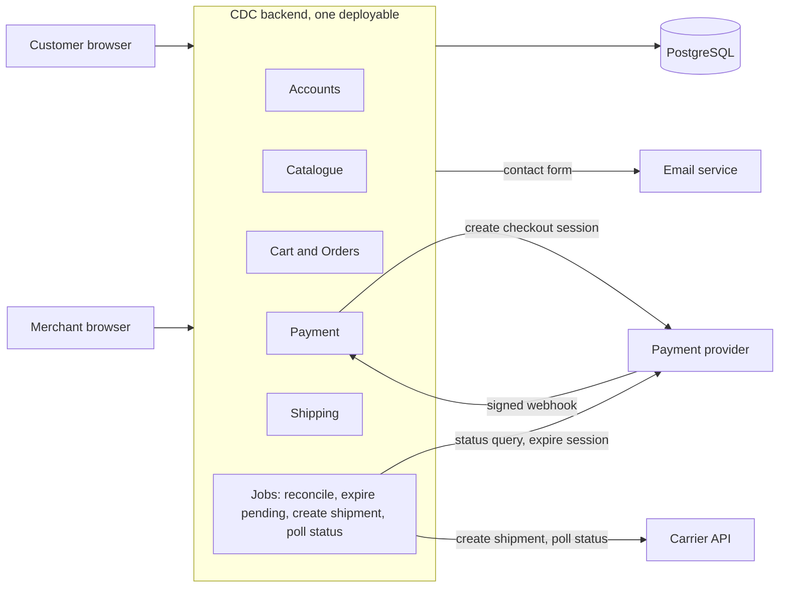

# ADR-001: Use a modular monolith for the CDC shop

- Status: accepted
- Date: 2026-10-29
- Deciders: Nikolas Gubancok, with Claude Code

## Context and problem statement

CDC is a web shop for hardware-store products with two roles, Customer and Merchant. It has 25 user stories: accounts and auth 7, catalogue browse, search and sort 8, cart 3, payment 1, package tracking 1, product management 2, About Us and contact 3.

The description says "CDC shop is a distributed system". No story needs this. The requirements give no numbers for users, traffic or catalogue size, and they don't name the payment provider, the carrier or the contact channel. The description says the shop handles shipment, but no story says who creates a shipment or sets the package status.

The architecture must cover all 25 stories and keep payment and stock correct, at a cost a small team can run.

## Decision drivers

- All 25 stories covered.
- "Distributed system" is a stated constraint. We challenge it but don't dismiss it.
- Payment correctness: a paid order is recorded once, even with duplicate or lost webhooks.
- Logout (8, 13) takes effect at once.
- A small team, with low operating cost.
- A path to split the system later if load or team size requires it.

## Considered options

1. Modular monolith with one PostgreSQL DB.
2. Three services (Identity, Catalogue, Ordering) behind an API gateway.
3. Option 2 plus events: an outbox and RabbitMQ, a CQRS read model for the catalogue, and `OrderPaid` driving shipping and email.

| Decision driver | 1. Monolith | 2. Three services | 3. Events + CQRS |
|---|---|---|---|
| All stories covered | Yes | Yes | Yes |
| "Distributed" constraint | Only via external parties | Met literally | Met literally |
| Payment correctness | One local transaction | One transaction inside Ordering | Same, plus outbox for `OrderPaid` |
| Logout | Immediate | Within ~5 s (gateway cache) | Within ~5 s |
| Failure isolation | All or nothing | Browsing survives an Ordering outage | As 2, consumer outages become queues |
| Operating cost | 1 app, 1 DB | 3 services, 3 DBs, gateway | As 2, plus broker, relay, rebuild script |
| Catalogue search and scale | DB queries | Catalogue scales alone | Search read model, seconds of lag |

## Decision outcome

Chosen option: 1, modular monolith.

It covers every story with one deployable and one DB, so cart, order, payment and stock share one transaction. The "distributed" constraint is met only by the parts that are already remote: browser to backend, the payment provider and its webhooks, the carrier API, the email service and the DB host. The modules follow the service cut of option 2, so Identity or Catalogue can be pulled out later.

### Design decisions inside option 1

- Payment uses the provider's hosted checkout. The webhook sets the order to paid. A reconcile job asks the provider about orders pending for more than ~15 min and uses the same pending-to-paid transition, so a payment applies once.
- The webhook handler verifies the signature over the raw body, stores the provider's event ID under a unique constraint, and commits before replying 200.
- Checkout locks the cart row and returns the existing pending order if the cart's items, quantities and prices are unchanged. It copies name and price into the order items and rejects removed products (soft delete).
- If the cart changed since the pending order was created, checkout expires that order's provider session and cancels it with the 24 h job's rules, and shows that order instead if the expiry fails because it was paid. If the expiry fails for another reason, checkout shows an error and asks the customer to retry. The provider call runs outside the cart lock, so checkout re-locks the cart and checks again for a pending order before creating a new one.
- Checkout asks the customer to confirm if the total differs from the one they last saw in the cart, and creates no order until they do.
- The provider session is created after the order commits, with the order ID as the idempotency key. `orders.provider_session_id` is nullable, and a retry gets the same session back.
- A job cancels orders pending for more than 24 h. It first asks the provider and expires the session, holding no row lock, and keeps the order if the expiry fails. The cancel is a conditional update from `pending`, so a webhook that lands in between wins.
- A payment webhook for a cancelled order is recorded and flags the order for the merchant to refund or reinstate. It doesn't decrement stock or create a shipment.
- The cart is not cleared at checkout. The webhook removes only the ordered items.
- `products.stock` is checked at checkout and decremented in the webhook transaction. There is no `CHECK (stock >= 0)`, because a paid webhook must not fail. Negative stock flags the order for the merchant.
- The webhook writes a `shipments` row with status `to_create`. A job creates the shipment at the carrier with the order ID as reference, and another job polls its status. Story 9 reads the `shipments` table.
- Login uses server-side sessions: a `sessions` table, an HttpOnly cookie and CSRF protection. Logout deletes the row. Merchant pages check `role = merchant`.

### Consequences

Good:
- Payment, stock and shipment handoff are consistent without an outbox or a saga.
- One app and one DB to deploy, back up and run locally.
- Logout works at once.

Bad:
- The app scales and fails as one unit. During an outage, customers who return from the provider see an error even though they paid (the webhook retry or the reconcile job fixes the order later).
- Module boundaries hold only by discipline.
- Stock can go negative when two customers pay for the last item at the same time.
- Late payments on cancelled orders are refunded or reinstated by the merchant by hand.
- A reviewer may read "distributed system" literally and reject a single backend.

### Assumptions

- Anonymous visitors can browse the catalogue and About Us (5, 6, 10, 11, 12).
- The customer profile holds a shipping address.
- The merchant has screens to see paid orders, set stock and handle flagged orders.
- Merchant accounts are created by seeding or by an admin. No story covers merchant registration.
- The contact form (23) sends an email to the shop.
- The payment provider offers hosted checkout, signed webhooks, idempotency keys and a status query. The carrier offers an API to create and track shipments.

### Not decided here

What the return page shows before the webhook arrives (decided only for option 3). How catalogue search is implemented. Refunds, order history and the tech stack. Each needs its own ADR.

### When to revisit

- Catalogue traffic or search needs outgrow the DB: option 3's read model, or pull Catalogue out as in option 2.
- Separate teams need independent deploys: option 2.
- More systems need to react to a paid order (ERP, analytics, more emails): option 3's `OrderPaid` event with an outbox.
- The course or a reviewer insists on the literal reading of "distributed": option 2.

## Pros and cons of the options

### 1. Modular monolith

- Good: one transaction for the payment flow, cheapest to run, immediate logout.
- Bad: one failure domain and one scaling unit. It meets "distributed" only through external parties.

### 2. Three services behind a gateway

- Good: browsing survives an Ordering outage, and Catalogue scales alone. Ordering keeps the one-transaction core.
- Bad: if Identity is down, every logged-in action fails after the ~5 s cache. If Catalogue is down, checkout and the cart view fail. Services must accept identity headers only from the gateway. The webhook path needs auth off and raw passthrough in the gateway config.

### 3. Events and CQRS

- Good: better catalogue search, and new consumers of `OrderPaid` don't touch Ordering.
- Bad: competing consumers reorder events, so the projector needs per-product versions. RabbitMQ has no replay, so rebuilds re-project from the write tables. Merchant and customer read paths can drift. The customer may see a price change seconds late.
